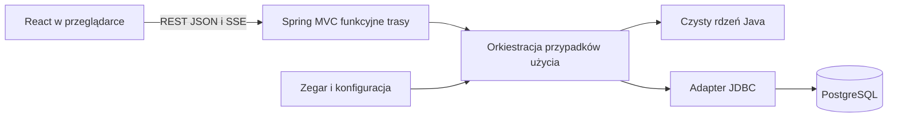

# Architektura i decyzje

## Granice

Strzałki pokazują zależności/wywołania. Rdzeń nie zależy od adapterów. App pobiera dane, przekazuje niemutowalne wartości do rdzenia i zapisuje wynik. Interfejs nigdy nie łączy się bezpośrednio z bazą.

## Docelowe moduły

- domain: typy nawyków, harmonogramów, wykonań, treningów, Result i błędów; czyste walidatory i obliczenia.
- application: koordynacja odczytów, obliczeń, transakcji, zegara i współbieżności.
- http: funkcyjne trasy MVC, JSON, filtry, odwzorowanie błędów, SSE.
- persistence: SQL, mapowanie wierszy na niemutowalne rekordy i transakcje JDBC.
- frontend: React/JSX/CSS, formularze, stan widoków i subskrypcje.

Pakiety domain, application, http i persistence są zaimplementowane dla kont i nawyków. Nie tworzymy pustych klas ani niepotrzebnych mikroserwisów.

## Plan danych

Zatwierdzone konta wieloużytkownikowe dodają account, access_key_verifier i session. Zasoby dziennika mają właściciela; odczyty, zapisy, raporty i SSE zawsze stosują zakres konta z uwierzytelnionej sesji. Szczegóły: authentication.md. Docelowy adres: https://nawyki.intmain.cc.

Zaimplementowane tabele: account, access_key_verifier, account_session, auth_rate_bucket, habit (dni harmonogramu jako integer[]) i habit_completion. Planowane: workout, workout_exercise, workout_set. Obce klucze, kolejność ćwiczeń/serii oraz UNIQUE(habit_id, completion_date). Kształt schematu, ograniczenia i migracje zostaną dopracowane razem z modelem. Option/Optional mapujemy na SQL NULL wyłącznie na granicy, nie wpuszczając null do rdzenia.

Trening i jego dzieci zapisujemy w jednej transakcji JDBC. Każda operacja współbieżna korzysta z własnych zasobów; nie przekazujemy wspólnego Connection między zadaniami. Publikacja zmiany do SSE następuje po zatwierdzeniu transakcji. Po ponownym połączeniu klient odświeża stan z REST, aby nie polegać na niezawodności ulotnych zdarzeń.

## Decyzje

| Decyzja | Powód / koszt |
|---|---|
| Java 21 | Zgodność z nauką na zajęciach; brak przewagi znajomości innych rozważanych języków. |
| MVC zamiast WebFlux | Zwykły model żądanie–odpowiedź; dwa SSE realizują potrzebne strumieniowanie. |
| JDBC zamiast R2DBC/JPA | Jawny SQL, prostsza nauka transakcji; nie potrzebujemy reaktywnego dostępu ani ORM. |
| PostgreSQL | Świadomy cel dalszej nauki, akceptacja konfiguracji serwera bazy. |
| Własny niewielki Result bez Vavr | Widoczny model funkcyjny w czystej Javie; nie budujemy ogólnej biblioteki funkcyjnej. |
| React w JavaScript | Nauka szeroko stosowanego interfejsu komponentowego; dodatkowy proces budowania. |
| Jeden VPS i zbudowany React w Springu | Jeden provider, adres i proces aplikacji; administracja VPS pozostaje naszą odpowiedzialnością. |

## Współbieżność

Plan: niezależne podsumowanie nawyków i podsumowanie treningów uruchamiane współbieżnie, następnie składane w raport. Jawny executor, ograniczona liczba zadań, niemutowalne wejścia i wyniki, obsługa błędów i zamykanie zasobów. Można wykorzystać wątki wirtualne Java 21 bez API preview. Implementacja musi pokazać rzeczywiście nakładającą się pracę, nie jedynie opakowanie sekwencji w Future.

## Transakcje nawyków

Zapis/cofnięcie wykonania i archiwizacja blokują wiersz nawyku SELECT ... FOR UPDATE z zakresem account_id. Po blokadzie ponownie odczytujemy niemutowalny rekord i sprawdzamy reguły. Unikalny klucz (habit_id, completion_date) oraz INSERT ... ON CONFLICT DO NOTHING zapewniają idempotencję także przy równoczesnych żądaniach. Złożony klucz obcy (account_id, habit_id) dodatkowo pilnuje właściciela wykonania. Nie zmieniamy harmonogramu po utworzeniu. Eksport i plan dnia są bieżącymi odczytami, bez gwarancji spójnego snapshotu wielu zapytań przy równoczesnej edycji.
